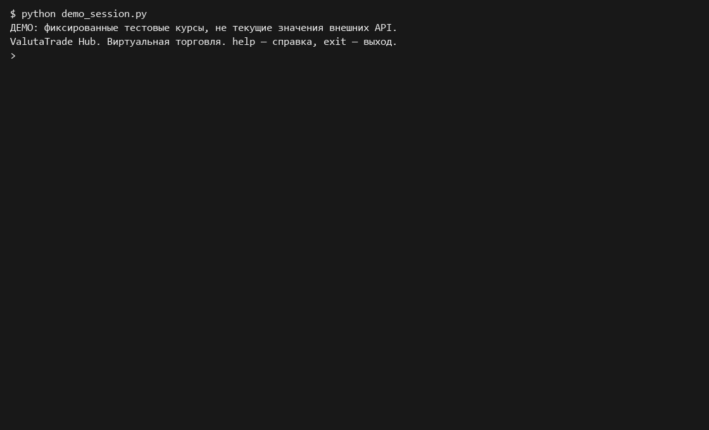

# ValutaTrade Hub

Итоговый проект по Python. Матвеенко Михаил Юрьевич, группа M26-555.

Приложение хранит виртуальные валютные кошельки, выполняет покупки и продажи
за USD и получает курсы через отдельный сервис. Реальные платежи не выполняются.

## Установка и запуск

Нужны uv и Python 3.12. При необходимости uv сам скачает нужный Python.
Все команды выполняются из папки проекта.

```console
uv sync
uv run valutatrade
```

Также можно запустить `uv run python main.py`.
`help` показывает команды, `help buy` — справку по конкретной команде,
`exit` или Ctrl+C завершают работу. Сессия входа действует в пределах
запущенной консоли; данные пользователей и кошельков сохраняются между запусками.

При установленном GNU Make работают `make install`, `make run`, `make lint`,
`make build` и `make parser`.

## Пример работы

Вводить внутри консоли:

```text
register --username alice --password 1234
login --username alice --password 1234
show-portfolio
deposit --amount 10000
update-rates
buy --currency EUR --amount 100
sell --currency EUR --amount 20
show-portfolio --base USD
get-rate --from USD --to BTC
show-rates --top 2
show-rates --currency RUB
show-rates --base EUR
logout
exit
```

Новый пользователь получает пустой портфель. Дополнительная команда `deposit`
пополняет виртуальный USD-кошелёк, чтобы можно было проверить торговлю.
Покупка списывает `amount × rate` USD, продажа зачисляет выручку обратно в USD.
`--amount` означает количество покупаемой или продаваемой валюты.
При нехватке средств операция не изменяет сохранённые балансы.

Поддерживаются USD, EUR, GBP, RUB, BTC, ETH и SOL. Коды нечувствительны к регистру.
Суммы должны быть положительными конечными числами: `nan`, `inf`, ноль
и отрицательные значения не принимаются.

## Курсы и Parser Service

CoinGecko используется для BTC, ETH и SOL. ExchangeRate-API — для EUR, GBP и RUB.
Курсы приводятся к направлению `валюта → USD`. Обратные и перекрёстные курсы
вычисляются по этому снимку. Например, ответ API с количеством EUR за 1 USD
инвертируется при сохранении EUR_USD.

Без ключа используется открытый endpoint ExchangeRate-API.
[Rates By Exchange Rate API](https://www.exchangerate-api.com).
Для доступа через персональный ключ задайте переменную окружения перед запуском.
Пример для PowerShell:

```powershell
$env:EXCHANGERATE_API_KEY = "ваш_ключ"
uv run valutatrade
```

Необязательный ключ CoinGecko задаётся через `COINGECKO_API_KEY`.
Ключи не нужно вставлять в исходники или добавлять в Git.
Файл `.env` не загружается автоматически: приложение читает переменные окружения.

Обновление из консоли:

```text
update-rates
update-rates --source coingecko
update-rates --source exchangerate
```

Отдельный запуск сервиса:

```console
uv run valutatrade-parser --once
uv run valutatrade-parser --interval 300
```

Второй вариант работает в текущем терминале до Ctrl+C.
Сбой одного источника не отменяет обновление второго. Если недоступны оба,
программа сообщает об ошибке и сохраняет предыдущие данные.

## Кэш и данные

По умолчанию срок актуальности курса — 300 секунд. Параметр
`rates_ttl_seconds` находится в `[tool.valutatrade]` файла `pyproject.toml`.
`get-rate` и торговые операции пытаются обновить отсутствующий или устаревший курс.
Если обновление не удалось, устаревший курс для сделки не используется.
`show-rates` читает только локальный кэш и помечает устаревшие строки.

`updated_at` — время получения ответа API в UTC. Для кросс-курса берётся
более раннее время из двух исходных котировок. `--top` выбирает только криптовалюты.
Повторные расчёты одного снимка кэшируются в замыкании; TTL проверяется при
каждом обращении, даже если расчёт уже есть в памяти.

Файлы создаются при запуске:

- `data/users.json` — пользователи, соль и SHA-256-хеши паролей;
- `data/portfolios.json` — кошельки пользователей;
- `data/rates.json` — последние курсы;
- `data/exchange_rates.json` — история измерений без повторения одинаковых ID.

JSON записывается через временный файл и атомарную замену. Обе стороны сделки
сохраняются одной записью файла портфелей. Журналы находятся в `logs/actions.log`
и `logs/parser.log`: формат JSON, ротация по размеру. Пароли и API-ключи
в журналы не записываются.

Настройки читает Singleton `SettingsLoader`, с файлами работает Singleton
`DatabaseManager`. Для другой папки данных можно задать `VALUTATRADE_DATA_DIR`,
для логов — `VALUTATRADE_LOG_DIR`, для своего конфигурационного файла —
`VALUTATRADE_CONFIG`. Поддерживаются JSON и TOML.

## Структура

```text
valutatrade_hub/
    core/
        currencies.py     — валюта, фиатные и криптовалютные классы
        exceptions.py     — ошибки предметной области
        models.py         — User, Wallet, Portfolio
        usecases.py       — регистрация, сессия, торговля, курсы
        utils.py          — общие проверки
    infra/
        settings.py       — конфигурация
        database.py       — JSON-хранилище
    parser_service/
        config.py         — параметры API
        api_clients.py    — клиенты источников
        storage.py        — снимок и история курсов
        updater.py        — обновление доступных источников
        scheduler.py      — разовый и периодический запуск
    cli/interface.py      — разбор команд и вывод
    decorators.py         — журналирование и кэш
    logging_config.py     — настройка журналов
main.py                   — запуск из корня проекта
```

## Проверка и сборка

```console
uv run ruff check .
uv run ruff format --check .
uv build
uvx twine check dist/*
```

Сборка и проверка метаданных выполняются локально, пакет не публикуется.
Собранный wheel можно установить отдельно:

```console
uv tool install dist/valutatrade_hub-0.1.0-py3-none-any.whl
valutatrade
```

## Демонстрация

В записи показаны регистрация, вход, пополнение, покупка, продажа, портфель,
получение и обновление курсов, а также ошибки ввода и нехватка средств.
Для повторяемости записи использованы явно отмеченные фиксированные тестовые
курсы. В обычном приложении подключены реальные API-клиенты.

Сценарий выполняется автоматически. Между командами добавлены паузы для чтения
таблиц и сообщений; GIF и запись asciinema показывают один и тот же сеанс.

[](docs/demo.cast)

[Запись asciinema](docs/demo.cast) · [Текст сеанса](docs/demo.txt)
